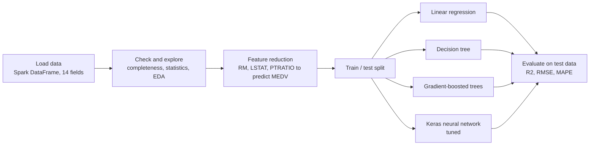

# House Price Prediction Capstone

IBM Advanced Data Science capstone notebook for house price prediction.

This early capstone is kept for education history. It covers exploratory data analysis, visualisation and predictive modelling in a Jupyter Notebook workflow.

## What the notebook does

## How to use

Open the notebook in Jupyter and run the cells in order. Review the data preparation, visual analysis and modelling steps before drawing conclusions.

## Limitations

This is a capstone project, not a production pricing system. Results depend on the dataset, feature choices and modelling assumptions in the notebook.
